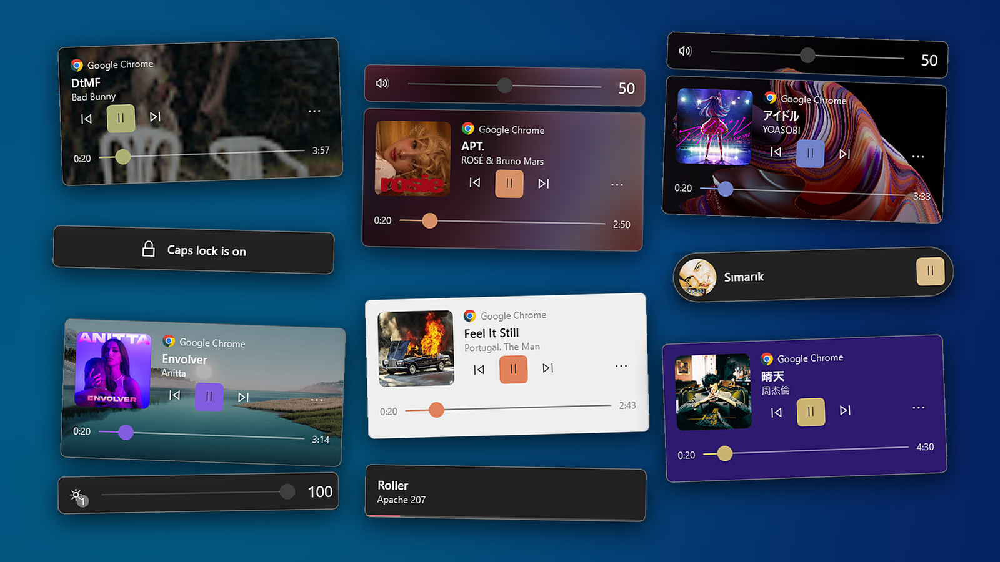
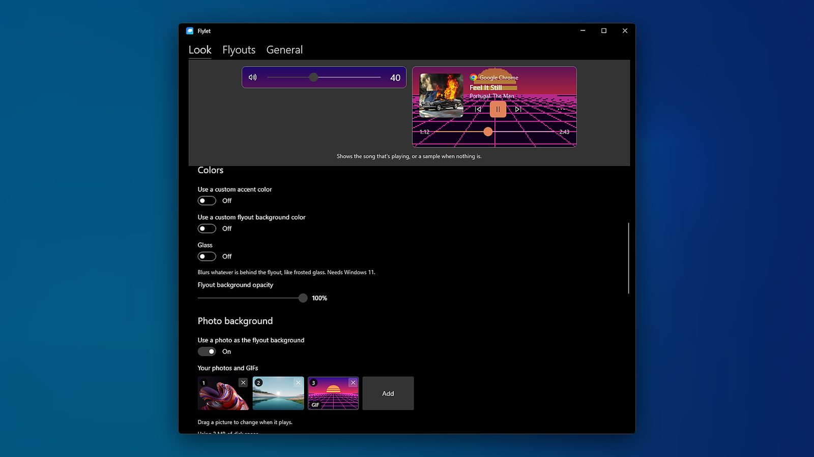

<p align="center">
  
</p>

<h1 align="center">Flylet</h1>

<p align="center">Modern, Fluent-style replacements for the Windows volume, brightness, media and lock-key pop-ups.</p>

<p align="center">
  
</p>

https://github.com/user-attachments/assets/f41658d0-7e60-4930-ac4a-4e72df447fa3

<p align="center"><sub>Song: Jim Yosef - Firefly [NCS Release] · Music provided by NoCopyrightSounds · <a href="http://ncs.io/Firefly">ncs.io/Firefly</a></sub></p>



Press a volume key and Windows shows its own small pop-up. Flylet hides that one and shows its
own instead: cleaner, with real media controls, and with a song timeline that actually keeps
moving while the music plays.

> Flylet is a maintained continuation of
> [ModernFlyouts](https://github.com/ModernFlyouts-Community/ModernFlyouts), which was archived in
> November 2025. Its original authors and contributors built the foundation of this project, and
> their work is used here under the MIT License. Flylet is not affiliated with them.

## What's new in 0.12

- **Glass:** blurs whatever is behind your pop-ups, like frosted glass (Windows 11)
- **Rotating backgrounds:** add several photos and GIFs and get a new one every time a pop-up opens, or on a timer
- **Opacity for your own photos and GIFs**, and photos that fit exactly as they look in the Adjust photo window
- **Media timeline for apps that can't seek:** it now shows whenever an app reports the song length, and apps with no timeline at all, like Edge on Windows 10, get an empty line instead of a gap
- **Runs on 32-bit (x86) PCs**, and uses almost no CPU when idle

Full notes: [Flylet 0.12.0 release](https://github.com/ItsMrZxD/Flylet/releases/tag/v0.12.0).

## What Flylet replaces

| Pop-up | What Flylet shows |
| --- | --- |
| Volume | A volume slider, plus the media player card when something is playing |
| Media | Album art, title, artist, play/pause, previous/next and a seekable timeline |
| Brightness | A brightness slider, on devices that support it |
| Lock keys | Caps Lock, Num Lock and Scroll Lock state |
| Airplane mode | Airplane mode on/off, on PCs with wireless radios |

It runs from the system tray, can start with Windows, and gets out of the way when you don't
need it.

## What's different from ModernFlyouts

- **The media timeline moves again.** Upstream only updated the song position when playback was
  paused, so the time sat frozen. Flylet estimates the position between reports and keeps
  counting. Sources that stop reporting a real timeline (Firefox, until the first pause) show an
  empty bar instead of a wrong one.
- **Windows 11 works again.** Windows 11 creates its flyout host only after the first volume
  press, and upstream only recognized the Windows 10 window class, so it never hid the new
  pop-up. Flylet recognizes both.
- **A redesigned media flyout:** album art on the left, and the play button and timeline take an
  accent color picked from the album art.
- **Your colors.** The flyouts follow your Windows accent color as it changes, and Settings >
  Look > Colors lets you pick a custom accent and flyout background. Text switches
  between light and dark to stay readable on the color you choose.
- **Translated.** Every string is translated in all 31 languages, with no half-English screens.
- **Up to date:** .NET 10, current dependencies, built with Visual Studio 2026.
- **Its own name and icon.**

## Requirements

- Windows 10 version 22H2, or Windows 11, on a 64-bit (x64) or 32-bit (x86) PC
- .NET 10 — bundled with the app, nothing to install separately

## Installing

Get Flylet from the
[Microsoft Store](https://apps.microsoft.com/detail/9NPSS6NW7T23). Updates arrive through the
Store automatically.

Or install it from the command line with winget:

```powershell
winget install 9NPSS6NW7T23 --source msstore
```

Store releases are signed by the Store, so the GitHub
[releases](https://github.com/ItsMrZxD/Flylet/releases) hold release notes only, with no
installer. To run it from source instead, see Building below.

## Building

You need Visual Studio 2026 with the **.NET desktop** and **C++ desktop** workloads, the
.NET 10 SDK, and Developer Mode turned on.

Build, install and launch a local test copy:

```powershell
tools\dev-install.ps1
```

It installs under a separate identity, "Flylet (Dev)", so it can be installed next to a Store copy.

Build only:

```powershell
msbuild Flylet.sln /restore /m /p:Configuration=Release /p:Platform=x64 /p:AppxBundle=Never
```

Run the tests:

```powershell
dotnet test Flylet.Core.Tests
```

`tools\make-icons.ps1` regenerates every app and package icon from code.

## How it works

Flylet watches window events on `explorer.exe` to spot the built-in flyout, hides it, and shows
its own window in its place. Media information comes from Windows' Now Playing session
(NPSM), so it works with any app that reports media to Windows.

## Performance

Measured on Flylet 0.11.2 (x64), as the process's working set, the same kind of number Task
Manager shows:

- About 66 MB right after starting, and about 110 MB once flyouts have shown.
- About 41–65 MB with **Use less memory** on (Settings → General → Performance).
- About 0% CPU when idle.

Photo and GIF backgrounds use more, depending on the image.

## Privacy

Flylet has no network code of its own and sends no data of its own. When you open Settings →
General, Windows' Store service checks whether a newer Flylet is available. The Store's rating
dialog, shown once, also talks to the Store. Flylet is open source, so anyone can check.

## Known limits

- Firefox sends Windows a 60x60 album image, so art looks soft for songs played there. Chrome
  sends 120x120. This is on Firefox's side.
- After seeking in Firefox, the song position stays off until the next pause.
- Releases are x86 and x64. ARM64 PCs run the x64 version under emulation; a native ARM64 build isn't released yet.

## Settings



## Credits

Flylet exists because of [ModernFlyouts](https://github.com/ModernFlyouts-Community/ModernFlyouts)
and everyone who worked on it, and because of
[ADeltaX](https://github.com/ADeltaX/), whose research made the original possible.
Third-party code and its licenses are listed in [NOTICE.md](NOTICE.md).

## License

[MIT](LICENSE) — the original copyright notice is kept alongside this project's.

The Flylet name and icon aren't covered by the MIT license. Please don't use them for other products or forks in a way that suggests they are the official Flylet.
